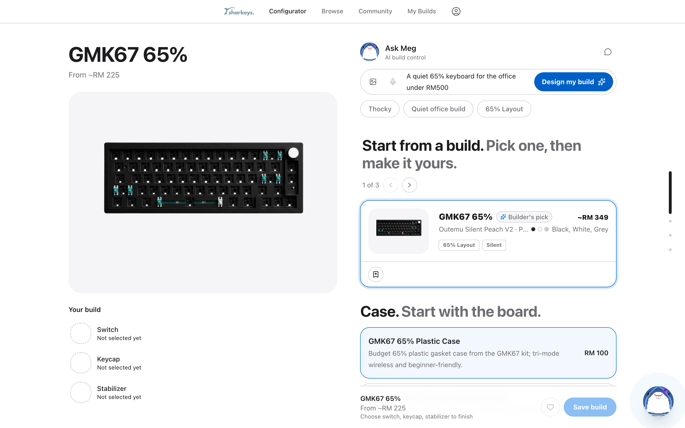
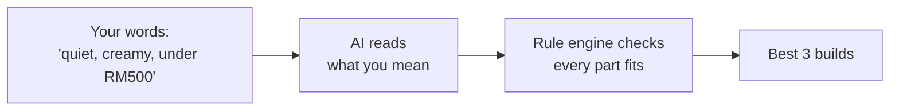

# Sharkeys

Describe the custom keyboard you want in your own words, and get complete builds where every part fits.

**Live demo: [sharkeys.vercel.app](https://sharkeys.vercel.app)**



## The problem

A custom keyboard is six parts bought separately: case, circuit board, plate, switches, keycaps and stabilisers. They have to fit each other. Get one wrong and the board can't be built, and most people find out after paying.

People also don't shop by spec. They ask for a keyboard that sounds "thocky" or feels "creamy". No product database stores those words, so a normal search can't answer the question people actually ask.

I've built and sold 150+ custom keyboards, and I built Sharkeys to answer that question properly.

## How it works

The AI reads what you mean. A rule engine (plain code, no AI) decides what fits. The AI can suggest and explain, but it can never approve: every build is checked by the rules before you see it.



## Results

| What was measured | Result | What it means |
|---|---|---|
| Possible builds from the catalog | 60 real parts, each checked as purchasable in Malaysia, combine 585,200 ways. The rules keep 3,250. You see the best 3. | Out of more than half a million combinations, you're shown three that are guaranteed to fit. |
| Recommended builds that pass the rules | 18 of 18 | No recommendation in testing was a build that can't be assembled. |
| Recommended parts that exist | 18 of 18 builds used only real catalog parts | The AI never slipped in a made-up product. |
| Hand-checked builds | 20 of 20 agreed with the rule engine | When I checked builds by hand, the rules got every one right. |
| 58-case test set, written from my selling experience | 57–58 of 58 with the AI on (6 runs), 54 of 58 with it off | It works well without AI. The AI's gain is in vague sound words like "creamy" and in expert advice. |
| User testing | 4 findings: 3 fixed in full, 1 in part | For example, colour requests like "purple and blue themed" were being ignored. They now shape the results. |

## Try it

Type one of these at [sharkeys.vercel.app/configurator](https://sharkeys.vercel.app/configurator):

- `A quiet 65% keyboard for the office under RM500`
- `Something thocky and deep sounding for gaming`
- `Purple and blue themed board, beginner friendly`

## Under the hood

**Stack:** Next.js and TypeScript; Supabase Postgres with pgvector, which lets the database search by meaning as well as by keyword; LangGraph to run Meg, the chat assistant, step by step; OpenAI; Vitest and Playwright for tests.

**Where things live:**

```
src/lib/rules/            the rule engine, the only authority on what fits
src/lib/ai/               turns a sentence into structured requirements
src/lib/recommendations/  assembles, checks and ranks builds
src/lib/agent/            Meg's steps: classify → extract → retrieve → validate → compose
src/lib/keybot/           Meg's grounded replies
src/app/api/              API routes
src/data/                 the parts catalog used when no database is configured
```

**Safety measures:**

- Every OpenAI call has a 7-second timeout and one retry, so a stuck request falls back in about 15 seconds instead of hanging.
- Messages to the AI routes are capped at 2,000 characters.
- On the live site, AI routes are rate-limited per visitor by a Vercel firewall rule (configured in the Vercel dashboard, not in this repo).
- If a visitor hits that limit (HTTP 429), the chat shows a friendly "please wait a few minutes" message instead of an error.
- It works fully without AI keys, using a keyword fallback to read requests.

## How it's tested

- **Unit and component tests:** 42 files, 234 passing tests. Another 42 are paused until they're updated for the current catalog.
- **Browser tests** with Playwright in `e2e/`.
- **`npm run verify`** runs typecheck, lint, tests and a production build. A change isn't done until it passes.
- **`npm run eval`** scores the 58-case test set offline, free and the same every run.

Every number in this README comes from a script, and the raw output is in [`evidence/`](evidence/).

## What it doesn't do

- No checkout or stock tracking. It recommends; you buy from the vendor.
- The catalog has 60 parts, so choice is limited.
- No build under RM250 yet. The cheapest valid build is RM281.
- Meg's replies arrive all at once and usually take 2–4 seconds. About a third of that is preparing the parts data before the AI is called.
- Colour preferences now affect ranking, but how much weight they get hasn't been tested with users yet.

## Run it locally

Requires Node.js 20 or newer.

```bash
npm install
cp .env.example .env.local
npm run dev
```

Then open http://localhost:3000.

**It works with no configuration.** Without any API keys the app uses a local catalog and a keyword-based request reader, which is enough to browse, configure and see recommendations. Add credentials to `.env.local` only if you want the live database and the AI features:

| Variable | What it enables | Required |
|---|---|---|
| `OPENAI_API_KEY` | AI request reading and the assistant | No |
| `NEXT_PUBLIC_SUPABASE_URL` | Live catalog and user accounts | No |
| `NEXT_PUBLIC_SUPABASE_ANON_KEY` | Live catalog and user accounts | No |
| `SUPABASE_SERVICE_ROLE_KEY` | Seeding the database (server only) | No |

```bash
npm run dev          # start the development server
npm run test         # unit and component tests
npm run eval         # score the AI against the 58-case test set
npm run verify       # typecheck, lint, test and production build
```

---

Built by Jayson.
